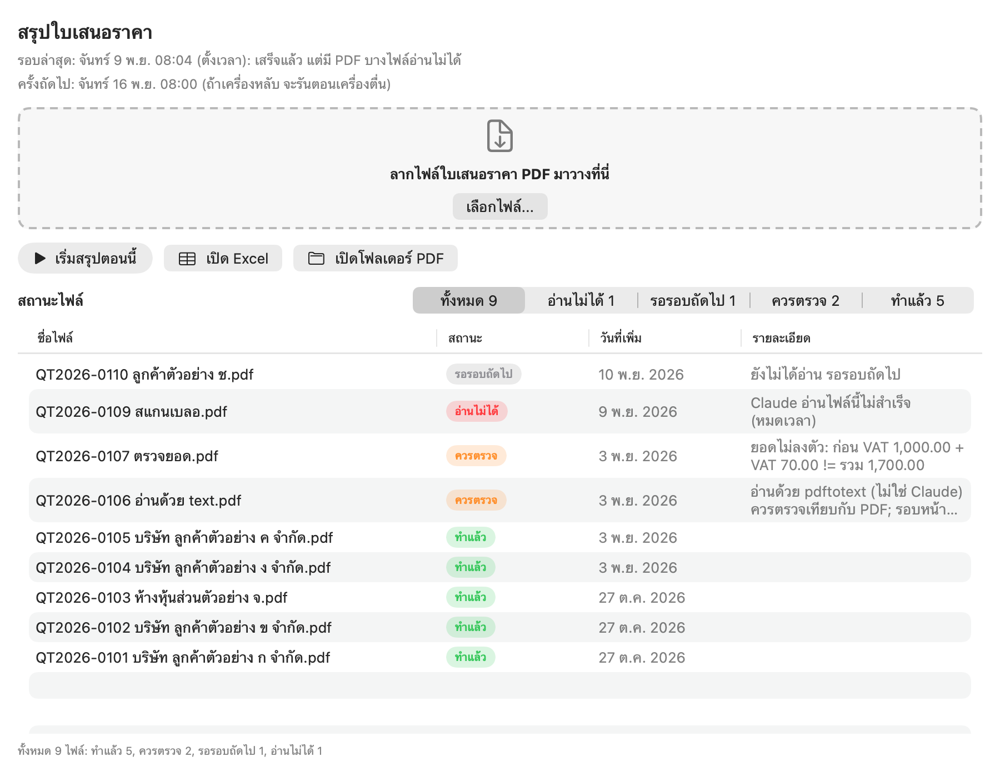
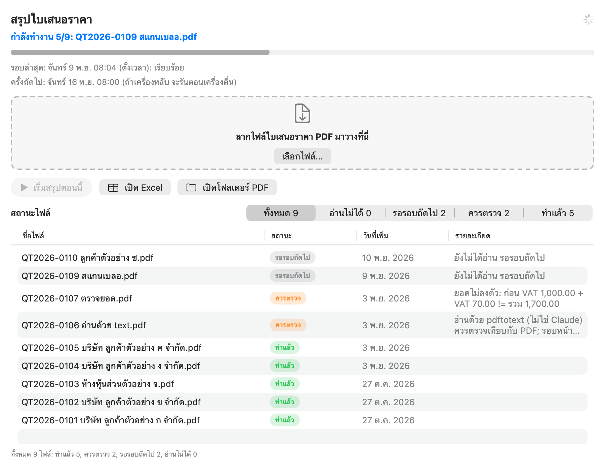
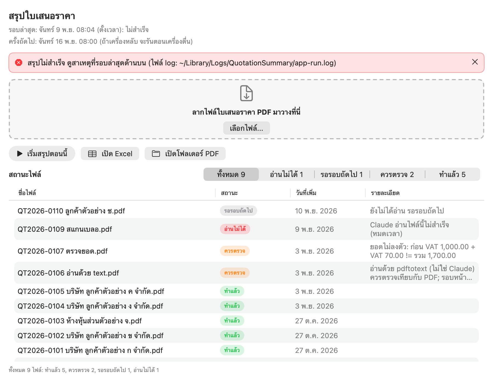

# quotation-summary

English | [ภาษาไทย](#ภาษาไทย)

A macOS tool that reads Thai quotation PDFs from one folder and builds an Excel summary every week.

- One Excel sheet per company you configure, plus a "สรุป" (summary) sheet: totals per company, per month and per week, and a list of items that need checking.
- Files that were already read are not read again (cache by file content), so each run only reads new PDFs.
- PDFs are read by Claude (headless Claude Code on your subscription, or an API key). If Claude is unavailable, a local fallback (`pdftotext`) reads the text and the row is flagged "check".
- A scheduled job (launchd) runs every Monday at 08:00 by default. A small SwiftUI desktop app lets you drop PDFs in, press "run now" and see the status of every file.
- The documents and the user interface are Thai. The code and comments are English.

## Screenshots

All screenshots use invented data (dummy companies, quote numbers and file names). They are rendered off-screen from the real SwiftUI views by `gui/Tests/QuotationSummaryAppTests/ScreenshotTests.swift`.

| Idle | Running | Error banner |
|---|---|---|
|  |  |  |

Status badges: `ทำแล้ว` = read by Claude and the numbers check out; `ควรตรวจ` = read, but compare it with the PDF (fallback reader, totals do not add up, seller not in your config, superseded revision); `รอรอบถัดไป` = not read yet; `อ่านไม่ได้` = the last attempt failed, it will be retried.

## Requirements

- macOS 13 or later. The app is built for Apple Silicon (arm64) only; there is no Intel build.
- Python 3.9 or later.
- One of:
  - a Claude subscription that supports Claude Code (Pro, Max, Ultra, Team or Enterprise), with Claude Code installed (default backend, `claude -p`), or
  - an Anthropic API key (`"claude_backend": "api"`, pay per use).
- Optional: `pdftotext` (`brew install poppler`) as a fallback reader when Claude is unavailable.
- Optional: Microsoft Excel. "Open Excel" falls back to the default app for `.xlsx`.
- To build the desktop app: Xcode Command Line Tools (`xcode-select --install`). No full Xcode needed.

## Install

The installer expects the program folder at `~/QuotationSummary/quotation-summary` (macOS blocks launchd jobs from reading Desktop, Documents, Downloads and iCloud Drive). `ติดตั้ง.command` ("install") moves it there.

### From a release zip

There is no published release yet. If you have a zip made by `scripts/make-package.sh` (see below):

1. Unzip it and double-click `ติดตั้ง.command` in the `quotation-summary` folder.
2. Follow the Terminal prompts. Every step says what it does and asks before anything that needs a password or a sign-in. It is safe to run again.
3. If macOS refuses to open the file, use System Settings > Privacy & Security > "Open Anyway", or type `bash ` in Terminal and drag the `.command` file onto the window.

The installer: checks Python, optionally installs `pdftotext` through Homebrew (never installs Homebrew itself), creates the virtualenv and `config.json`, registers the weekly job, installs the app to `~/Applications/สรุปใบเสนอราคา.app`, creates the PDF folder, installs Claude Code if missing, stores your Claude token in the macOS Keychain, runs a first test and prints a pass/fail checklist.

### Build from source

```sh
git clone https://github.com/korakod-dev/quotation-summary.git
cd quotation-summary

# 1. Build the desktop app only (ad-hoc signed, no Apple developer account needed)
scripts/build-app.sh --out build            # -> build/QuotationSummary.app

# 2. Build an install zip (rebuilds the app, packs the tracked files, verifies the zip).
#    The zip must be written outside any git work tree.
scripts/make-package.sh ~/Desktop/quotation-summary.zip --allow-no-config
```

`make-package.sh` packs the tracked files except the Swift sources (`gui/`), `docs/`, `.gitignore` and `build-app.sh`, plus the built app and your local `config.json` (if you have one; it holds real company data, so never publish a zip made with it). `--allow-no-config` packs the example config instead. `--no-app` skips the desktop app. Then install from the zip as described above.

Running `ติดตั้ง.command` directly inside a git clone stops after step 1 on purpose (the weekly job would point at the clone). Use `--allow-dev-checkout` on `scripts/setup-all.command` only if you know you want that.

### Manual install

```sh
mkdir -p ~/QuotationSummary && cp -R quotation-summary ~/QuotationSummary/
cd ~/QuotationSummary/quotation-summary
scripts/install.sh                          # venv, packages, config.json, weekly job
# optional: QS_WEEKDAY=5 QS_HOUR=17 scripts/install.sh   (Friday 17:00)
```

## Configuration

`config.json` is not in git because it holds company names and tax IDs. Copy the template and edit it:

```sh
cp config.example.json config.json
```

- `companies`: one entry per seller. `sheet_name` = Excel sheet name, `display_name`, `tax_id` (13 digits), `aliases` (name fragments used for matching). A quotation from a seller that matches none of them goes to the sheet `ไม่ระบุบริษัท` and a warning appears in the summary sheet.
- `source_folder`: where the PDFs live (default `~/QuotationSummary/ใบเสนอราคาที่ขายงานได้`). Keep it outside Desktop/Documents/Downloads/iCloud.
- `output_file`: Excel path (empty = inside the source folder, `สรุปใบเสนอราคา.xlsx`).
- `extractor`: `auto` (Claude, fall back to `pdftotext`), `claude` (Claude or stop), `text` (local only, no Claude).
- `claude_backend`: `claude_code` (subscription, default) or `api` (API key).
- `claude_model`, `claude_code_max_files_per_run` (default 50 per run), `claude_code_timeout_sec`, `cache_file`, `max_pdf_mb`: see `config.example.json`.

The example file contains dummy companies ("Company A/B", tax IDs `0100000000001` and `0100000000002`). Replace them.

### Claude access

Subscription (default): install Claude Code, run `claude setup-token` (sign in in the browser, copy the token), then double-click `scripts/set-claude-token.command` and paste it (hidden input). The token goes to the macOS Keychain, not to a file. The first run asks for Keychain access: choose "Always Allow".

API key: set `"claude_backend": "api"` in `config.json`, then double-click `scripts/set-api-key.command`.

## Usage

- Desktop app: open "สรุปใบเสนอราคา", drop PDFs on the drop zone (or "เลือกไฟล์..."), press "เริ่มสรุปตอนนี้" ("run now"), then "เปิด Excel". The app only calls the same engine the schedule uses; it never reads PDFs itself.
- Terminal: double-click `scripts/run-now.command`, or run `scripts/run.sh` (`--offline` = no Claude, `--reextract` = ignore the cache, `--folder <dir>`).
- Check the installation: double-click `ตรวจระบบ.command` (doctor).
- Logs: `~/Library/Logs/QuotationSummary/run.log` (scheduled runs), `app-run.log` (runs started from the app).

## Weekly schedule

`install.sh` writes `~/Library/LaunchAgents/com.korakod.quotation-summary.plist`, which runs `scripts/run.sh` every Monday at 08:00 (change it with `QS_WEEKDAY`, `QS_HOUR`, `QS_MINUTE` when installing). If the Mac is asleep at that time, launchd runs the job when it wakes. If the Mac is fully off, that week is skipped: use "run now".

## Uninstall

Double-click `ถอนการติดตั้ง.command` ("uninstall"). It first lists everything it found, then deletes nothing until you type `ลบ` (or `DELETE`) and press Enter. It removes the launchd job, Keychain items, cache and logs, the installed folder and the app. Your PDFs and Excel files, Claude Code itself and your own `~/.claude` are kept unless you answer yes to the optional questions (default is no). `--dry-run` shows the plan without deleting. Deletions are permanent. Manual alternative: `scripts/uninstall.sh` (stops the schedule only).

## Privacy

- When Claude is used, the PDF content (customer names, prices, tax IDs) is sent to Anthropic, with both the subscription and the API key. For a fully local run set `"extractor": "text"` (less accurate).
- With the subscription backend the data falls under your Claude account's privacy settings. See https://code.claude.com/docs/en/data-usage and consider turning off the model-improvement setting in your account's privacy controls (https://claude.ai/settings/data-privacy-controls).
- Each PDF is read by a separate `claude -p` process that only sees a temporary copy of that PDF, uses only the `Read` tool, has no MCP servers, keeps no session transcript (`--no-session-persistence`) and uses an isolated Claude Code config folder, so it does not see your other projects or settings.
- The cache stores extracted fields only: no PDFs, tokens or keys.
- `config.json`, `config.json.*`, `tests/samples.local.json` and `*.zip` are in `.gitignore`. A zip made by `make-package.sh` with your `config.json` contains your company data: do not publish it.

## Terms of service caveat

Running Claude Code non-interactively (`claude -p`) with a token from `claude setup-token` uses your Claude subscription for automated processing. Anthropic's Claude Code documentation describes `claude setup-token` as creating a long-lived token for use in scripts and CI (https://code.claude.com/docs/en/authentication). This project has not verified that Anthropic's consumer terms cover automated processing of business documents this way. If Anthropic reads the terms differently, your account could be limited. Whether to use a subscription this way is your own responsibility. If you want to avoid the question, use the API-key backend (`"claude_backend": "api"`), which falls under Anthropic's commercial terms.

## Status of the project

- Covered by automated tests: the extraction pipeline with a stub Claude, the `pdftotext` fallback, Excel output, the cache, the status contract between the engine and the app, the installer, doctor, packager and uninstaller (against fake homes and fake `launchctl`, `security`, `claude`, `brew` commands), and the desktop app's models and view model.
- Not verified: answers from a real Claude subscription or API key on real quotation PDFs. Run a few real PDFs first and compare the Excel with the PDFs before you rely on it.
- Not verified on real machines: opening `ติดตั้ง.command` on macOS 15 and later (Gatekeeper behaviour), the launchd schedule over several weeks, drag-and-drop with the mouse, "Open Excel" with a real Excel.

## Tests

```sh
# Python (engine, scripts, installer): 355 tests, about 2 minutes
python3 -m venv .venv && .venv/bin/pip install -r requirements.txt
.venv/bin/python -m unittest discover -s tests

# Swift (desktop app): swift-testing, ships with the Command Line Tools
swift test --package-path gui
# The first build sometimes fails with "plugin for module 'TestingMacros' not found". Run it again.

# Regenerate the README screenshots (writes PNGs only when QS_SCREENSHOT_DIR is set)
QS_SCREENSHOT_DIR=$PWD/docs/screenshots swift test --package-path gui --filter ScreenshotTests
```

`tests/test_text_samples.py` checks the `pdftotext` reader against real sample PDFs and is skipped unless you provide them (`QS_SAMPLES`, `tests/samples.local.json`; see `tests/samples.local.example.json`). The GUI fixtures `gui/Tests/QuotationSummaryAppTests/Fixtures/status-*.json` are generated by `tests/make_gui_fixtures.py`; `tests/test_contract.py` fails if the engine output drifts from them. The `shot-*.json` fixtures (invented data for the screenshots) are hand-written; a Swift test decodes them on every `swift test`.

## License

MIT. See [LICENSE](LICENSE). Copyright (c) 2026 korakod-dev.

---

<a id="ภาษาไทย"></a>

# ภาษาไทย

[English](#quotation-summary) | ภาษาไทย

## โปรแกรมนี้ทำอะไร

อ่านไฟล์ PDF ใบเสนอราคา (ภาษาไทย) จากโฟลเดอร์เดียว แล้วสร้างไฟล์ Excel สรุปให้ใหม่ทุกสัปดาห์

- Excel มี 1 ชีตต่อบริษัทที่ตั้งไว้ และมีชีต "สรุป" บอกยอดรวมแยกบริษัท แยกเดือน แยกสัปดาห์ และรายการที่ควรตรวจ
- PDF ที่เคยอ่านแล้วจะไม่ถูกอ่านซ้ำ (จำจากเนื้อไฟล์ ไม่ใช่จากชื่อไฟล์) แต่ละสัปดาห์จึงอ่านเฉพาะไฟล์ใหม่
- ตัวที่อ่าน PDF คือ Claude (ผ่าน Claude Code ด้วยแพ็กเกจรายเดือนของคุณ หรือผ่าน API key) ถ้า Claude ใช้ไม่ได้ จะใช้ตัวอ่านสำรอง (`pdftotext`) แล้วติดป้าย "ควรตรวจ" ให้
- โปรแกรมรันเองทุกวันจันทร์ 08:00 (เปลี่ยนเวลาได้) และมีแอปหน้าต่างให้ลากไฟล์มาวาง กดเริ่มสรุป และดูสถานะของทุกไฟล์

## ภาพหน้าจอ

ทุกภาพใช้ข้อมูลที่แต่งขึ้นเอง (บริษัทสมมติ เลขที่ใบเสนอราคาสมมติ ชื่อไฟล์สมมติ) ไม่มีข้อมูลจริง ภาพถูกวาดจากหน้าต่างจริงของแอปโดยไม่ต้องเปิดแอปให้เห็นบนจอ (ดูไฟล์ `ScreenshotTests.swift`)

| ว่าง (รอสั่ง) | กำลังทำงาน | แถบข้อความผิดพลาด |
|---|---|---|
|  |  |  |

ความหมายของป้ายสถานะ:

- ทำแล้ว: Claude อ่านแล้ว และตัวเลขผ่านการตรวจ
- ควรตรวจ: อ่านได้ แต่ให้เทียบกับ PDF อีกครั้ง เช่น อ่านด้วยตัวสำรอง ยอดไม่ลงตัว ผู้ขายไม่ตรงกับบริษัทใน config หรือเป็นฉบับเก่าที่ถูกแทนด้วยฉบับแก้ไข คอลัมน์ "รายละเอียด" บอกเหตุผล
- รอรอบถัดไป: ยังไม่ได้อ่าน (เพิ่งวางไฟล์เข้ามา)
- อ่านไม่ได้: ครั้งที่แล้วอ่านไม่สำเร็จ รอบถัดไปจะลองใหม่เอง

## สิ่งที่ต้องมี

- macOS 13 ขึ้นไป แอปที่ build เป็นชนิดสำหรับ Mac ชิป Apple (arm64) เท่านั้น ไม่มีชนิด Intel
- Python 3.9 ขึ้นไป
- อย่างใดอย่างหนึ่ง:
  - แพ็กเกจ Claude รายเดือนที่ใช้ Claude Code ได้ (Pro, Max, Ultra, Team หรือ Enterprise) พร้อมติดตั้ง Claude Code (ทางเริ่มต้น)
  - API key ของ Anthropic (ตั้ง `"claude_backend": "api"` จ่ายตามการใช้งาน)
- ไม่บังคับ: `pdftotext` (`brew install poppler`) เป็นตัวอ่านสำรองตอน Claude ใช้ไม่ได้
- ไม่บังคับ: Microsoft Excel (ถ้าไม่มี ปุ่ม "เปิด Excel" จะเปิดด้วยโปรแกรมเริ่มต้นของไฟล์ `.xlsx`)
- ถ้าจะ build แอปเอง: Xcode Command Line Tools (`xcode-select --install`) ไม่ต้องใช้ Xcode เต็มตัว

## ติดตั้ง

ตัวติดตั้งจะวางโปรแกรมไว้ที่ `~/QuotationSummary/quotation-summary` เพราะ macOS ไม่ให้งานตั้งเวลา (launchd) อ่านโฟลเดอร์ Desktop, Documents, Downloads และ iCloud Drive ถ้าวางผิดที่ งานตั้งเวลาจะไม่สร้าง Excel โดยไม่มีข้อความเตือน ไฟล์ `ติดตั้ง.command` ย้ายโฟลเดอร์ไปที่นั่นให้เอง

### จากไฟล์ zip

ตอนนี้ยังไม่มี zip ที่ปล่อยให้โหลดสำเร็จรูป ถ้าคุณมี zip ที่สร้างด้วย `scripts/make-package.sh` (วิธีสร้างอยู่ด้านล่าง):

1. แตกไฟล์ แล้วดับเบิลคลิก `ติดตั้ง.command` ในโฟลเดอร์ `quotation-summary`
2. ทำตามที่ Terminal บอกทีละขั้น ทุกขั้นจะบอกก่อนว่าทำอะไร และถามก่อนทุกอย่างที่ต้องใช้รหัสผ่านหรือต้องล็อกอิน รันซ้ำได้ปลอดภัย
3. ถ้า macOS ไม่ยอมเปิดไฟล์ ให้ไปที่ การตั้งค่าระบบ > ความเป็นส่วนตัวและความปลอดภัย แล้วกด "เปิดต่อไป" (Open Anyway) หรือเปิด Terminal พิมพ์ `bash ` (มีเว้นวรรคท้าย) แล้วลากไฟล์ `.command` มาวาง กด Enter

ตัวติดตั้งทำสิ่งเหล่านี้: เช็ก Python, ถามก่อนติดตั้ง `pdftotext` ผ่าน Homebrew (ไม่ติดตั้ง Homebrew ให้), สร้างสภาพแวดล้อม Python กับไฟล์ `config.json`, ตั้งเวลาทุกวันจันทร์, ติดตั้งแอปไปที่ `~/Applications/สรุปใบเสนอราคา.app`, สร้างโฟลเดอร์เก็บ PDF, ติดตั้ง Claude Code ถ้ายังไม่มี, เก็บ token ของ Claude ไว้ใน Keychain (ที่เก็บรหัสผ่านของ macOS), ทดสอบรันหนึ่งครั้ง และแสดงรายการผ่าน/ไม่ผ่าน

### Build จากซอร์สโค้ด

```sh
git clone https://github.com/korakod-dev/quotation-summary.git
cd quotation-summary

# 1. build เฉพาะแอปหน้าต่าง (เซ็นแบบ ad-hoc ไม่ต้องมีบัญชีนักพัฒนา Apple)
scripts/build-app.sh --out build            # ได้ build/QuotationSummary.app

# 2. สร้าง zip สำหรับติดตั้ง (build แอปใหม่ แพ็กไฟล์ที่ git ติดตามอยู่ แล้วตรวจ zip ให้)
#    ที่เก็บ zip ต้องอยู่นอกโฟลเดอร์ที่ git ดูแลอยู่
scripts/make-package.sh ~/Desktop/quotation-summary.zip --allow-no-config
```

`make-package.sh` แพ็กไฟล์ที่ git ติดตามอยู่ ยกเว้นโค้ด Swift (`gui/`), `docs/`, `.gitignore` และ `build-app.sh` แล้วเพิ่มตัวแอปที่ build แล้ว และ `config.json` ของคุณถ้ามี (ในนั้นมีข้อมูลบริษัทจริง จึงห้ามเอา zip แบบนี้ไปเผยแพร่) `--allow-no-config` คือแพ็กโดยใช้ค่าตัวอย่างแทน `--no-app` คือไม่ใส่แอปหน้าต่าง จากนั้นติดตั้งจาก zip ตามหัวข้อข้างบน

ถ้าดับเบิลคลิก `ติดตั้ง.command` ตรงๆ ในโฟลเดอร์ที่ clone มา มันจะหยุดหลังขั้นแรกโดยตั้งใจ (เพราะงานตั้งเวลาจะชี้มาที่โฟลเดอร์ clone ซึ่งมักอยู่ใน Desktop ที่ macOS กันไว้) ใช้ `--allow-dev-checkout` กับ `scripts/setup-all.command` เฉพาะเมื่อแน่ใจว่าต้องการแบบนั้น

### ติดตั้งเองทีละขั้น

```sh
mkdir -p ~/QuotationSummary && cp -R quotation-summary ~/QuotationSummary/
cd ~/QuotationSummary/quotation-summary
scripts/install.sh                          # สร้าง venv ติดตั้งแพ็กเกจ สร้าง config.json ตั้งเวลารายสัปดาห์
# เปลี่ยนเวลาได้: QS_WEEKDAY=5 QS_HOUR=17 scripts/install.sh   (วันศุกร์ 17:00)
```

## ตั้งค่า (config.json)

`config.json` ไม่อยู่ใน git เพราะมีชื่อบริษัทและเลขผู้เสียภาษี ให้คัดลอกไฟล์แม่แบบแล้วแก้:

```sh
cp config.example.json config.json
```

- `companies`: บริษัทผู้ขายแต่ละแห่ง (1 แห่งต่อ 1 ชีต) `sheet_name` = ชื่อชีต, `display_name` = ชื่อเต็ม, `tax_id` = เลขผู้เสียภาษี 13 หลัก, `aliases` = ส่วนของชื่อที่ใช้จับคู่ ถ้าใบเสนอราคามีผู้ขายที่ไม่ตรงกับบริษัทไหนเลย ใบนั้นจะไปอยู่ชีต "ไม่ระบุบริษัท" และมีข้อความเตือนในชีต "สรุป" จะไม่หายเงียบ ๆ
- `source_folder`: โฟลเดอร์เก็บ PDF (ค่าเริ่มต้น `~/QuotationSummary/ใบเสนอราคาที่ขายงานได้`) ควรอยู่นอก Desktop/Documents/Downloads/iCloud
- `output_file`: ที่เก็บไฟล์ Excel (เว้นว่าง = ไว้ในโฟลเดอร์ PDF ชื่อ `สรุปใบเสนอราคา.xlsx`)
- `extractor`: `auto` (ใช้ Claude ถ้าใช้ไม่ได้ก็ใช้ `pdftotext`), `claude` (ต้องใช้ Claude ได้ ไม่งั้นหยุด), `text` (อ่านในเครื่องอย่างเดียว ไม่ใช้ Claude)
- `claude_backend`: `claude_code` (แพ็กเกจรายเดือน ค่าเริ่มต้น) หรือ `api` (API key)
- `claude_model`, `claude_code_max_files_per_run` (ค่าเริ่มต้น 50 ไฟล์ต่อรอบ), `claude_code_timeout_sec`, `cache_file`, `max_pdf_mb`: ดูใน `config.example.json`

ไฟล์ตัวอย่างใช้บริษัทสมมติ ("Company A/B" เลขภาษี `0100000000001` และ `0100000000002`) ให้แทนที่ด้วยข้อมูลของคุณ

### ให้โปรแกรมใช้ Claude ได้

แพ็กเกจรายเดือน (ค่าเริ่มต้น): ติดตั้ง Claude Code แล้วรัน `claude setup-token` (เบราว์เซอร์เปิดให้ล็อกอิน แล้วคัดลอก token ที่แสดง) จากนั้นดับเบิลคลิก `scripts/set-claude-token.command` แล้ววาง token (ตัวอักษรจะไม่แสดงบนจอ) token ถูกเก็บใน Keychain ไม่ถูกเขียนลงไฟล์ ครั้งแรกที่โปรแกรมอ่าน Keychain macOS จะถามสิทธิ์ ให้กด "Always Allow"

API key: ตั้ง `"claude_backend": "api"` ใน `config.json` แล้วดับเบิลคลิก `scripts/set-api-key.command`

## วิธีใช้

- แอปหน้าต่าง: เปิด "สรุปใบเสนอราคา" ลากไฟล์ PDF มาวางในช่องประ (หรือกด "เลือกไฟล์...") กด "เริ่มสรุปตอนนี้" แล้วกด "เปิด Excel" แอปไม่ได้อ่าน PDF เอง มันสั่งโปรแกรมตัวเดียวกับที่ตั้งเวลาไว้ ผลจึงเหมือนกัน
- Terminal: ดับเบิลคลิก `scripts/run-now.command` หรือรัน `scripts/run.sh` (`--offline` = ไม่ใช้ Claude, `--reextract` = ไม่ใช้ cache อ่านใหม่ทุกไฟล์, `--folder <โฟลเดอร์>`)
- ตรวจการติดตั้ง: ดับเบิลคลิก `ตรวจระบบ.command`
- ไฟล์ล็อก: `~/Library/Logs/QuotationSummary/run.log` (รอบตั้งเวลา) และ `app-run.log` (รอบที่กดจากแอป)

## ตั้งเวลารายสัปดาห์

`install.sh` สร้างไฟล์ `~/Library/LaunchAgents/com.korakod.quotation-summary.plist` สั่งให้ macOS รัน `scripts/run.sh` ทุกวันจันทร์ 08:00 (เปลี่ยนได้ด้วย `QS_WEEKDAY`, `QS_HOUR`, `QS_MINUTE` ตอนติดตั้ง) ถ้าเครื่องหลับอยู่ตอนนั้น จะรันเมื่อเครื่องตื่น ถ้าเครื่องปิดสนิท สัปดาห์นั้นจะข้าม ให้กด "เริ่มสรุปตอนนี้" แทน

## ถอนการติดตั้ง

ดับเบิลคลิก `ถอนการติดตั้ง.command` โปรแกรมจะไล่ดูก่อนว่ามีอะไรติดตั้งอยู่ แล้วสรุปให้ดู ยังไม่ลบอะไรจนกว่าคุณจะพิมพ์ `ลบ` (หรือ `DELETE`) แล้วกด Enter สิ่งที่ลบ: งานตั้งเวลา, รายการใน Keychain, cache และล็อก, โฟลเดอร์โปรแกรมที่ติดตั้ง และแอป ส่วน PDF กับ Excel ของคุณ, ตัว Claude Code เอง และโฟลเดอร์ `~/.claude` ของคุณ จะไม่ถูกแตะ เว้นแต่ตอบ "ใช่" ในคำถามเสริม (ค่าเริ่มต้นคือไม่) ใส่ `--dry-run` เพื่อดูแผนโดยไม่ลบจริง การลบกู้คืนไม่ได้ ทางสำรอง: `scripts/uninstall.sh` (หยุดแค่การตั้งเวลา)

## ข้อมูลส่วนตัว

- เมื่อใช้ Claude เนื้อหาใน PDF (ชื่อลูกค้า ราคา เลขผู้เสียภาษี) จะถูกส่งออกจากเครื่องไปที่ Anthropic ไม่ว่าจะใช้แพ็กเกจรายเดือนหรือ API key ถ้าไม่ต้องการให้ข้อมูลออกจากเครื่อง ให้ตั้ง `"extractor": "text"` (อ่านในเครื่องทั้งหมด แต่แม่นยำน้อยกว่า)
- ทางแพ็กเกจรายเดือน ข้อมูลอยู่ภายใต้การตั้งค่าความเป็นส่วนตัวของบัญชี Claude ของคุณ ดู https://code.claude.com/docs/en/data-usage และควรพิจารณาปิดการตั้งค่าอนุญาตให้นำข้อมูลไปพัฒนาโมเดล (model-improvement) ในหน้าความเป็นส่วนตัวของบัญชี (https://claude.ai/settings/data-privacy-controls)
- PDF แต่ละไฟล์ถูกอ่านด้วย `claude -p` แยกกันทีละไฟล์ ซึ่งเห็นแค่สำเนาชั่วคราวของไฟล์นั้น ใช้เครื่องมืออ่านไฟล์อย่างเดียว ไม่มี MCP ไม่เก็บบันทึกการสนทนา (`--no-session-persistence`) และใช้โฟลเดอร์ตั้งค่าแยกต่างหาก จึงไม่เห็นโปรเจกต์หรือการตั้งค่าอื่นของคุณ
- cache เก็บเฉพาะข้อมูลที่ดึงออกมา ไม่เก็บ PDF, token หรือ key
- `.gitignore` กันไว้แล้ว: `config.json`, `config.json.*`, `tests/samples.local.json`, `*.zip` และ zip ที่สร้างด้วย `make-package.sh` พร้อม `config.json` ของคุณมีข้อมูลบริษัทจริง ห้ามเผยแพร่

## ข้อควรรู้เรื่องเงื่อนไขการใช้งาน (ToS)

การรัน Claude Code แบบไม่ต้องมีคนกด (`claude -p`) ด้วย token จาก `claude setup-token` คือการใช้แพ็กเกจรายเดือนของคุณประมวลผลเอกสารอัตโนมัติ เอกสาร Claude Code ของ Anthropic อธิบายว่า `claude setup-token` สร้าง token อายุยาวไว้ใช้กับสคริปต์และ CI (https://code.claude.com/docs/en/authentication) แต่โปรเจกต์นี้ยังไม่ได้ยืนยันว่าเงื่อนไขฉบับเต็มของ Anthropic สำหรับแพ็กเกจผู้ใช้ทั่วไปครอบคลุมการประมวลผลเอกสารธุรกิจแบบนี้ ถ้า Anthropic ตีความต่างออกไป บัญชีของคุณอาจถูกจำกัดการใช้งาน การตัดสินใจใช้แพ็กเกจรายเดือนแบบนี้เป็นความรับผิดชอบของคุณเอง ถ้าไม่อยากรับความเสี่ยงนี้ ให้ใช้ทาง API key (`"claude_backend": "api"`) ซึ่งอยู่ภายใต้เงื่อนไขแบบธุรกิจของ Anthropic

## สถานะของโปรเจกต์

- มีเทสต์อัตโนมัติครอบคลุม: ขั้นตอนอ่านและสรุป (ใช้ Claude จำลอง), ตัวอ่านสำรอง `pdftotext`, การสร้าง Excel, cache, ข้อตกลงข้อมูลสถานะระหว่างโปรแกรมหลักกับแอป, ตัวติดตั้ง ตัวตรวจระบบ ตัวแพ็ก ตัวถอน (ทดสอบกับบ้านปลอมและคำสั่งปลอมแทน `launchctl`, `security`, `claude`, `brew`) และส่วนข้อมูลของแอปหน้าต่าง
- ยังไม่ได้ยืนยันกับของจริง: คำตอบจาก Claude จริง (แพ็กเกจรายเดือนหรือ API key) กับ PDF ใบเสนอราคาจริง ก่อนใช้งานจริงให้ลองกับ PDF จริงสัก 2-3 ใบ แล้วเทียบ Excel กับ PDF
- ยังไม่ได้ลองบนเครื่องจริง: การเปิด `ติดตั้ง.command` บน macOS 15 ขึ้นไป (ตัวกันของ macOS), การตั้งเวลา launchd ต่อเนื่องหลายสัปดาห์, การลากไฟล์ด้วยเมาส์, ปุ่ม "เปิด Excel" กับ Excel จริง

## รันเทสต์

```sh
# Python (โปรแกรมหลัก สคริปต์ ตัวติดตั้ง) 355 เทสต์ ใช้เวลาราว 2 นาที
python3 -m venv .venv && .venv/bin/pip install -r requirements.txt
.venv/bin/python -m unittest discover -s tests

# Swift (แอปหน้าต่าง) ใช้ swift-testing ที่มากับ Command Line Tools
swift test --package-path gui
# build ครั้งแรกบางครั้งล้มด้วยข้อความ "plugin for module 'TestingMacros' not found" ให้รันซ้ำอีกครั้ง

# สร้างภาพหน้าจอใน README ใหม่ (เขียนไฟล์ PNG เฉพาะเมื่อตั้ง QS_SCREENSHOT_DIR)
QS_SCREENSHOT_DIR=$PWD/docs/screenshots swift test --package-path gui --filter ScreenshotTests
```

`tests/test_text_samples.py` ตรวจตัวอ่านสำรองกับ PDF ตัวอย่างจริง จะข้ามไปถ้าไม่มีไฟล์ (ตั้ง `QS_SAMPLES` และ `tests/samples.local.json` ดูรูปแบบที่ `tests/samples.local.example.json`)

ไฟล์ตัวอย่างของแอปหน้าต่าง `gui/Tests/QuotationSummaryAppTests/Fixtures/status-*.json` สร้างจาก `tests/make_gui_fixtures.py` และ `tests/test_contract.py` จะล้มถ้าผลลัพธ์ของตัวโปรแกรมเปลี่ยนไปจากไฟล์เหล่านี้ ส่วน `shot-*.json` (ข้อมูลสมมติสำหรับภาพหน้าจอ) เขียนมือ และมีเทสต์ Swift ถอดรหัสให้ทุกครั้งที่รัน `swift test`

## สัญญาอนุญาต

MIT ดูไฟล์ [LICENSE](LICENSE) ลิขสิทธิ์ (c) 2026 korakod-dev
